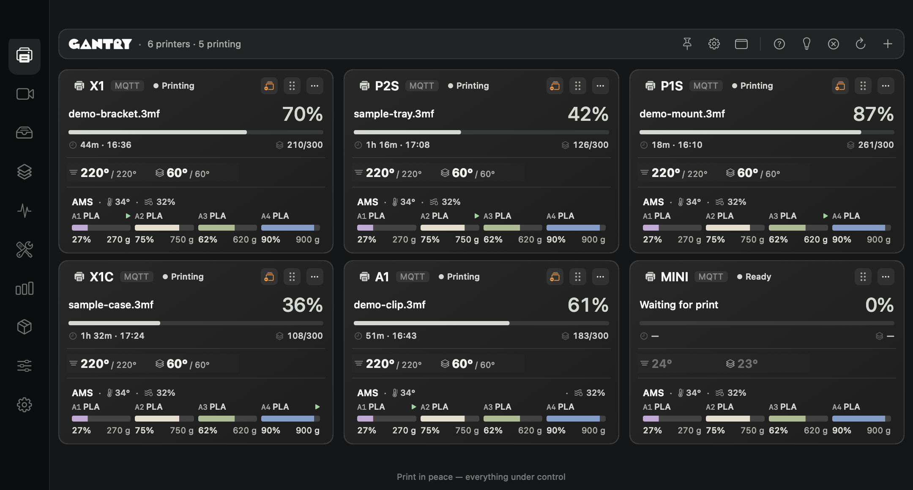
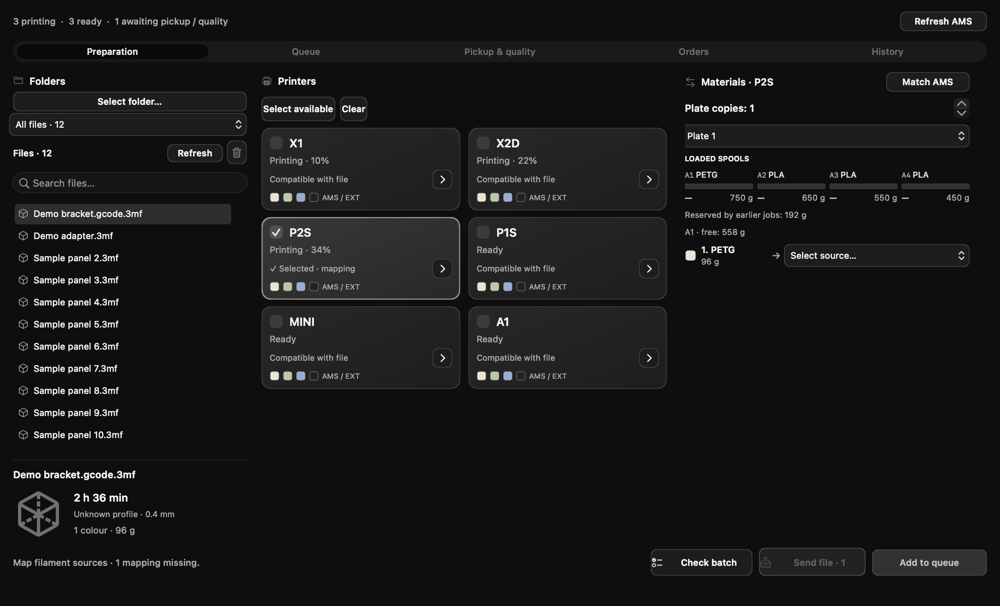
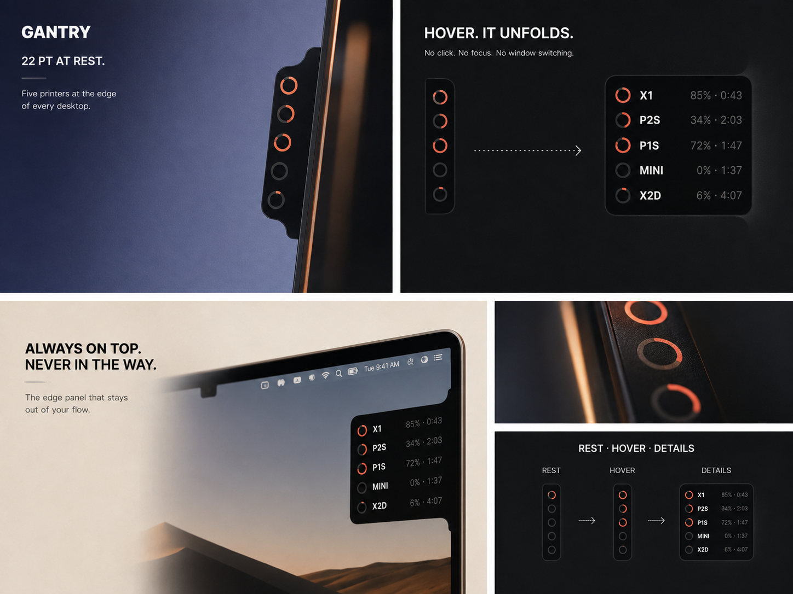

# Gantry

### Your 3D printer fleet. One place.

Follow prints, organise filament, plan production and understand costs. Local monitoring, with optional access through your own hosting.

**English** · **[Polski](README.pl.md)**

**[Download](https://github.com/parametryczny/Gantrybar/releases/latest)** · **[Quick start](docs/wiki/Getting-started-EN.md)** · **[Guides](docs/wiki/Home.md)** · **[What’s new](docs/release-0.14.0.md)**

  

**macOS · Windows · Linux**

> **Release status:** the current public release is **0.12.0**. Screenshots and guides below preview **0.14.0**, which is still in development. Its release remains a draft; these additions are not included in the current stable download.

*Actual Gantry interface, rendered with fictional printer data. Modern theme, 0.14 preview.*

Gantry keeps the fleet close: a menu-bar or tray preview, a full window, or a compact edge panel. Check progress, remaining time, temperatures, loaded filament and camera feeds without opening a separate slicer for every printer.

## Explore Gantry 0.14

| Area | What it helps you do |
| --- | --- |
| **Fleet** | Follow live status and cameras, receive notifications and adjust each printer’s tools. Choose Basic, Modern or a minimal LITE view. [Views](docs/wiki/Appearance-and-LITE-EN.md) · [Printer tools](docs/wiki/Printer-tools-EN.md) |
| **Farm** | Search sliced files, choose compatible printers, map materials and plan batches. Track pickup, quality checks and manual orders. [Farm guide](docs/wiki/Farm-EN.md) |
| **Filament** | See AMS, HT, MMU and external spools. Manage physical rolls in Spoolbase and link them to loaded slots. [Spoolbase](docs/wiki/Spoolbase-EN.md) |
| **Energy & costs** | Record metering-socket readings throughout a print, review history and export reports. Measured, partial and estimated values remain distinguishable. [Energy and reports](docs/wiki/Energy-and-reports-EN.md) |
| **Vision & maintenance** | Review suspected print failures, label frames and keep service tasks, schedules, problems and parts together. [Vision](docs/wiki/Gantry-Vision-EN.md) · [Maintenance](docs/wiki/Maintenance-EN.md) |
| **Remote access** | View the fleet on your LAN or generate a configured website package for your own hosting. Add Telegram alerts if you want them. [Web dashboard](docs/wiki/Web-dashboard-EN.md) |

### A fleet view that fits your day

Start with one printer and bring the next ones into the same view. Cards show the job name, progress, remaining time and finish time, layers, temperatures and loaded filament. Available readings and their visibility depend on the device and card settings.

The **full window** provides room for the fleet and navigation between modules. The **menu bar or system tray** offers a quick status check while you work. The **edge panel** keeps selected printers within sight; choose expansion on hover or only after clicking. Pinning the full window preserves its position on the monitor you are using.

Choose **Basic** or **Modern**, a light or dark theme and the readings you need. Open Details for temperature traces, fans, speed, materials and the camera. The shared header also lets you switch lighting on or off across connected printers that support the command.

### From file to finished batch

*Native Farm preview with demonstration files, printer states and an example order.*

Prepare a file, select printers and map materials in one workspace. Queue batches, confirm pickup and accept or reject finished copies. Manual orders link a reference, SKU, quantity and deadline to a sliced plate. **WooCommerce and Etsy integrations are planned.**

Uploading a file alone does not start a print. Queue starts require explicit approval of a prepared, empty bed; Gantry does not reslice a file for a different printer.

**A practical workflow:** search for a fictional file such as `demo-bracket.3mf`, select compatible printers, check materials and plan the number of plate copies. The plan accounts for earlier jobs and filament reservations; adding a batch alone does not start machines. After removing a print, confirm the empty bed and assess the finished copies.

- The library includes folders by printer family, search, refresh and removal of a file together with its recorded original to trash, provided no job or queue item uses it.
- Preparation, Queue, Pickup & quality, Orders and History have separate tabs. Check file, nozzle and material compatibility before uploading.
- Accepted copies fulfil an order. A rejected copy can create a held reprint with its reason recorded; reservations help avoid allocating the same filament to several batches.
- Supported files include sliced 3MF for Bambu Lab and G-code for compatible Klipper, PrusaLink and OctoPrint printers. Gantry is not a slicer; selecting another folder does not change a print profile.

[Complete Farm workflow](docs/wiki/Farm-EN.md).

### Filament: from an AMS slot to a physical roll

The **AMS / Filaments** view brings a selected printer’s modules together. Colour slots show material, the active source, percentage and grams; modules may also report temperature and humidity. Click a slot for details and to assign a roll from Spoolbase.

Spoolbase separates a **filament definition** — brand, series and colour — from an **individual physical roll** with its own remaining quantity, price and location. Two identical spools can have different balances; moving a partly used roll to another printer should not create an inventory duplicate. RFID recognition or a unique match helps with assignment; multiple matching rolls require a user choice.

Import order items from text or an image read locally through OCR, check quantities and the per-roll price, use manufacturer palettes and print QR labels. **Hide EXT separately for each printer**, including its web preview, without shifting AMS/HT assignments. [Spoolbase and the roll lifecycle](docs/wiki/Spoolbase-EN.md).

### Cameras and Gantry Vision

Camera previews appear in Details, Monitoring and selected strip views. The Monitoring wall adapts its columns to the window. You can configure a separate HTTP/HTTPS JPEG or MJPEG camera for a printer; Gantry also respects rotation and flips saved in Moonraker webcam settings.

**Gantry Vision** observes the image while printing and reports suspected problems such as spaghetti or detached parts. The Fast model ships with the app; you can select another compatible model and adjust sensitivity. Repeated observations reduce reliance on a single frame but do not guarantee failure detection.

Label correct and defective frames, inspect the archive and export evaluation data. Dark-chamber notices apply to active printing. An alert can include the frame that triggered it. **Labelling does not automatically train model weights**, and a result always needs checking against the image. [Vision and evaluation data](docs/wiki/Gantry-Vision-EN.md).

### What did the print actually cost?

Connect a supported Tasmota or Shelly socket with power metering. Gantry records readings in the background throughout the observed cycle, including preparation reported as an active job and pauses. **Details do not need to stay open.** The Gantry computer must remain running; sleep or unavailable readings leave a measurement gap.

History distinguishes measured, partially measured and estimated energy based on average wattage. Costs can include filament, electricity and machine time; pricing accounts for configured labour, packaging, platform commission and a failed-print allowance. Results depend on the rates you enter and available data.

Statistics show production and printer utilisation. The download icon beside a job saves its TXT data report; CSV export covers the history. A report is not the original model or G-code file. [Energy, pricing and exports](docs/wiki/Energy-and-reports-EN.md).

### Maintenance, problems and parts

Schedule service by printing hours, days or both. Create checklists and templates, follow progress and record completed work with a note, part and cost. The problem register supports photos and priorities; parts inventory tracks quantities and minimum stock.

**In service** status excludes a printer from new Farm assignments, uploads and starts. It does not interrupt a running print. A user-confirmed Vision defect can become a problem with a photo; a model prediction alone does not create a report. [Maintenance and service](docs/wiki/Maintenance-EN.md).

### Access from a phone and your own hosting

Enable the local preview server to view the fleet on a reachable LAN. The desktop panel uses side navigation; on a phone, navigation moves to the bottom and printer cards stack vertically. A local address alone does not provide access outside your home Wi-Fi.

For internet access, use the **website package generator**: enter the final address and Gantry prepares website files with bridge configuration. Upload the extracted package to your own PHP hosting with HTTPS, then enable synchronisation in the app. The computer initiates the connection to hosting, so this option needs no router port forwarding.

Camera sharing and additional data sharing are separate choices. Viewing Farm, costs, Spoolbase or service does not provide every desktop form. Optional control must be enabled; the local panel is read-only. Sign-in can be remembered for 30 days. [LAN, hosting and dashboard scope](docs/wiki/Web-dashboard-EN.md).

### Printer tools and automations

Select a device in **Printer settings** to bring its connection, EXT visibility, camera, web panel, socket and cost parameters together. A custom HTTP button can send a manual GET or POST request. PrusaLink, Moonraker and OctoPrint support an alternate API address and different polling intervals during activity and idle time.

Sockets and relays can use supported Tasmota, Shelly, Home Assistant integrations or custom control URLs. Power switching alone does not imply energy metering; capabilities depend on the device and integration.

Automation rules connect a trigger — such as progress, a layer or a state change — to a supported action, including a notification, lighting or pause. Available commands depend on the printer and firmware; test custom commands before enabling a rule. [Printer tools](docs/wiki/Printer-tools-EN.md).

### Only need status? Choose LITE

The **LITE** switch in advanced settings reduces the full app to printer status in the menu bar or system tray. It hides the larger modules and most of their preferences. Printers, history and inventory stay saved; returning to full mode restores access to the tools.

Switching requires a restart. It does not shrink the same application package; a standalone Gantry LITE installation is a separate app variant. [Basic, Modern and LITE](docs/wiki/Appearance-and-LITE-EN.md).

## Download and start

Get the installer from **[the latest public release](https://github.com/parametryczny/Gantrybar/releases/latest)**. Choose the package for your system:

| System | Package |
| --- | --- |
| macOS | `Gantry-*-macOS.dmg`; alternative storage builds are ZIP archives |
| Windows x64 | `Gantry-Setup-Windows-x64.exe` or portable `Gantry-Windows-x64.zip` |
| Linux | `.deb`, `.rpm` or portable `.AppImage` |

Windows release packages include their runtime. Package requirements and installation notes belong to the selected release.

1. Install Gantry and allow local-network access when prompted.
2. Choose **Add printer…**, select its type and enter its address and required credentials.
3. Check the status card, then open Details to verify available readings and the camera.
4. Enable the optional modules you need. [Continue with the quick start](docs/wiki/Getting-started-EN.md).

### Printers

Bambu Lab · Anycubic Kobra S1 · Elegoo Centauri Carbon / CC2 · Klipper / Moonraker · PrusaLink · Snapmaker. The 0.14 preview also includes OctoPrint.

Available readings, filament systems, cameras and control commands depend on the printer and its firmware. [Connection requirements and protocols](docs/connections-EN.md).

## Your data, your setup

Local monitoring requires no Gantry account or Gantry-operated server. Optional hosting and Telegram send the data needed for the integrations you enable; remote viewing requires the Gantry computer to stay running and connected.

Vision can miss failures or raise false alarms. Confirm results against the camera image. Labelling a frame does **not** automatically retrain model weights. [How Vision works](docs/wiki/Gantry-Vision-EN.md).

## More views

<strong>The edge panel</strong> — a compact view beside your work

Existing promotional illustration. The current app lets you choose expansion on hover or click, select printers and show camera previews. [View settings](docs/wiki/Appearance-and-LITE-EN.md).

<strong>Telegram</strong> — notifications and fleet access on your phone

Your own bot sends finish, error, pause and low-filament alerts to the configured chat. Check the fleet or a single printer, recent prints and a camera photo from your phone. Buttons expose supported controls; quiet hours and temporary muting help manage notifications.

The Gantry computer bridges the connection to Telegram and must remain running and online. [Telegram setup, commands and controls](docs/wiki/Telegram-EN.md).

## Guides and community

[All PL/EN guides](docs/wiki/Home.md) · [Troubleshooting](docs/wiki/Troubleshooting-EN.md) · [Release notes](docs/release-0.14.0.md)

Found a problem? [Open an issue](https://github.com/parametryczny/Gantrybar/issues) with your Gantry version, printer model, operating system and steps to reproduce. Remove access codes and other private data from logs and screenshots.

Created by **[Kamil Grzegorczyk / parametryczny](https://github.com/parametryczny)**. [Support development](https://buycoffee.to/parametryczny) · [Contribute](CONTRIBUTING.md) · [MIT license](LICENSE).
