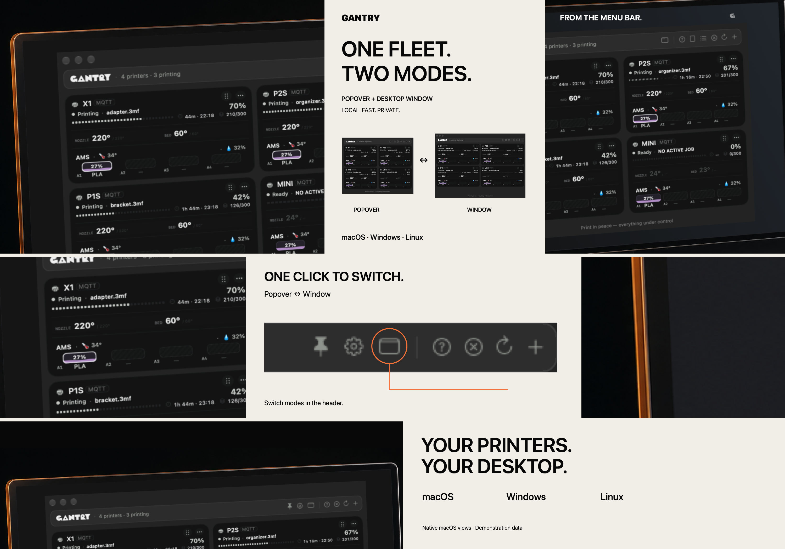
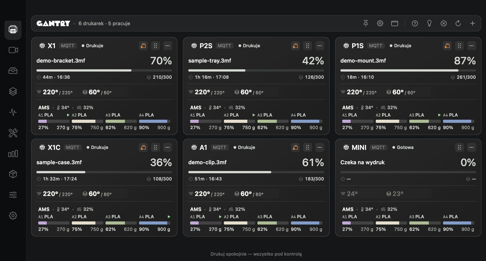
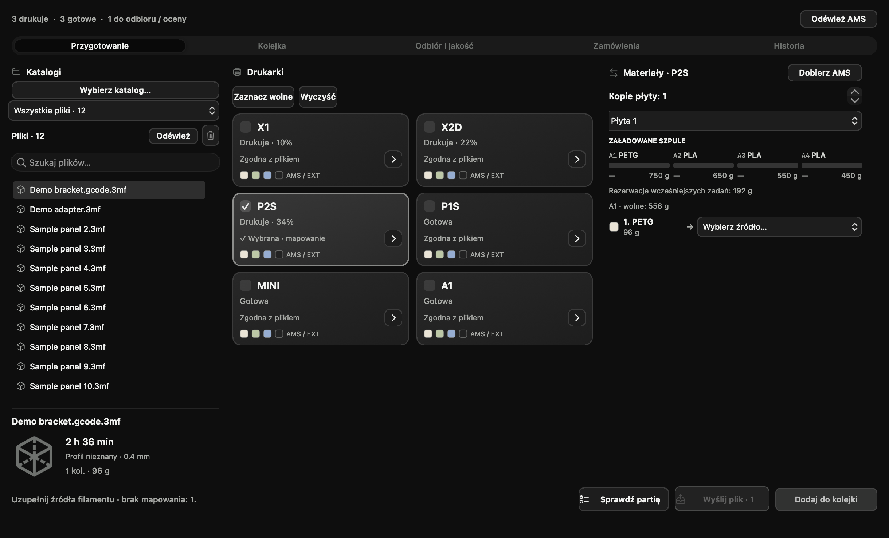
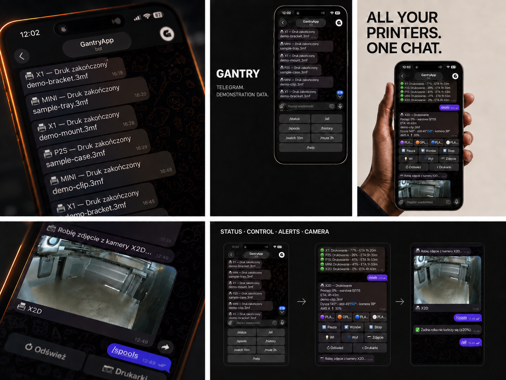

# Gantry

### Twoja flota drukarek 3D w jednym miejscu.

Monitoruj wydruki, zarządzaj filamentem, planuj produkcję i sprawdzaj koszty. Lokalnie, z opcjonalnym dostępem przez własny hosting.

**[English](README.md)** · **Polski**

**[Pobierz](https://github.com/parametryczny/Gantrybar/releases/latest)** · **[Pierwsze kroki](docs/wiki/Getting-started-PL.md)** · **[Poradniki](docs/wiki/Home.md)** · **[Co nowego](docs/release-0.14.0.md)**

  

**macOS · Windows · Linux**

> **Status wydania:** aktualna publiczna wersja to **0.12.0**. Poniższe zrzuty i poradniki przedstawiają **0.14.0**, nad którą nadal pracujemy. Jej wydanie pozostaje szkicem; tych nowości nie ma jeszcze w aktualnym stabilnym pakiecie.

*Render promocyjny Gantry z demonstracyjnymi nazwami zadań. Poniżej znajdziesz także aktualny podgląd Modern i Farmy 0.14.*

Gantry daje podgląd floty w pasku menu lub zasobniku, pełnym oknie albo wąskim panelu przy krawędzi ekranu. Sprawdzisz postęp, pozostały czas, temperatury, załadowany filament i kamery bez otwierania osobnego slicera dla każdej drukarki.

## Poznaj Gantry 0.14

| Obszar | W czym pomaga |
| --- | --- |
| **Flota** | Śledź stan i kamery, odbieraj powiadomienia i ustawiaj narzędzia poszczególnych drukarek. Wybierz Basic, Modern albo ograniczony tryb LITE. [Widoki](docs/wiki/Appearance-and-LITE-PL.md) · [Narzędzia drukarki](docs/wiki/Printer-tools-PL.md) |
| **Farma** | Wyszukuj pocięte pliki, dobieraj zgodne drukarki, mapuj materiały i planuj partie. Kontroluj odbiór, jakość i ręczne zamówienia. [Poradnik Farmy](docs/wiki/Farm-PL.md) |
| **Filamenty** | Podglądaj AMS, HT, MMU i szpule zewnętrzne. Zarządzaj fizycznymi rolkami w Spoolbase i przypisuj je do załadowanych slotów. [Spoolbase](docs/wiki/Spoolbase-PL.md) |
| **Energia i koszty** | Zapisuj pomiary gniazdka przez cały wydruk, przeglądaj historię i eksportuj raporty. Odróżniaj dane zmierzone, częściowe i szacowane. [Energia i raporty](docs/wiki/Energy-and-reports-PL.md) |
| **Vision i serwis** | Sprawdzaj podejrzenia defektów, oznaczaj klatki i prowadź zadania serwisowe, harmonogramy, problemy oraz części. [Vision](docs/wiki/Gantry-Vision-PL.md) · [Konserwacja](docs/wiki/Maintenance-PL.md) |
| **Dostęp zdalny** | Podglądaj flotę w LAN lub wygeneruj skonfigurowaną paczkę strony na własny hosting. Opcjonalnie dodaj powiadomienia Telegram. [Panel WWW](docs/wiki/Web-dashboard-PL.md) |

### Flota, którą masz pod ręką

*Dotychczasowy render trybów okna i paska, z demonstracyjnymi plikami i wcześniejszym układem kart.*

Zacznij od jednej drukarki, a kolejne dodawaj do tego samego widoku. Karty pokazują nazwę zadania, postęp, pozostały czas i godzinę zakończenia, warstwy, temperatury oraz załadowany filament. Dostępne odczyty i ich widoczność zależą od urządzenia oraz ustawień karty.

**Pełne okno** daje miejsce na całą flotę i boczną nawigację między modułami. **Pasek menu lub zasobnik** pozwala szybko sprawdzić stan podczas innej pracy. **Panel przy krawędzi** utrzymuje wybrane drukarki w zasięgu wzroku; może rozwijać się po najechaniu albo dopiero po kliknięciu. Pinezka pełnego okna zachowuje jego położenie na używanym monitorze.

Wybierz szablon **Basic** lub **Modern**, jasny albo ciemny motyw i potrzebne odczyty. Otwórz Szczegóły, gdy chcesz zobaczyć wykres temperatur, wentylatory, prędkość, materiały i kamerę. Wspólny nagłówek pozwala też włączyć lub zgasić światło we wszystkich połączonych drukarkach obsługujących tę komendę.

Aktualny interfejs Modern — podgląd 0.14

*Rzeczywisty interfejs Gantry z fikcyjnymi danymi drukarek. Motyw Modern, podgląd 0.14.*

### Od pliku do gotowej partii

*Podgląd natywnej Farmy z przykładowymi plikami, stanami drukarek i zamówieniem.*

W jednym widoku wybierzesz plik, drukarki i źródła materiałów. Zaplanujesz partie, potwierdzisz odbiór i zaakceptujesz lub odrzucisz gotowe kopie. Ręczne zamówienia łączą numer, SKU, ilość i termin z pociętą płytą. **Integracje z WooCommerce i Etsy są planowane.**

Samo wysłanie pliku nie uruchamia druku. Start z kolejki wymaga wyraźnego zatwierdzenia pustego, przygotowanego stołu; Gantry nie przelicza pliku na profil innej drukarki.

**Praktyczny przebieg pracy:** wyszukaj np. fikcyjny `demo-bracket.3mf`, wybierz zgodne drukarki, sprawdź materiały i zaplanuj liczbę kopii płyty. Plan uwzględnia wcześniejsze zadania i rezerwacje filamentu; samo dodanie partii nie uruchamia maszyn. Po zdjęciu wydruku potwierdzasz pusty stół, a następnie oceniasz jakość gotowych kopii.

- Biblioteka ma katalogi według rodzin drukarek, wyszukiwarkę, odświeżanie i usuwanie pliku wraz z zapisanym oryginałem do kosza, jeśli nie jest używany przez zadanie lub kolejkę.
- Przygotowanie, kolejka, odbiór i jakość, zamówienia oraz historia mają osobne zakładki. Zgodność pliku, dyszy i materiałów można sprawdzić przed wysyłką.
- Do zamówienia zaliczają się zaakceptowane kopie. Odrzucona kopia może utworzyć wstrzymany ponowny druk z zapisanym powodem; rezerwacje pomagają uniknąć planowania tego samego filamentu dla kilku partii.
- Obsługiwane pliki obejmują pocięte 3MF dla Bambu Lab oraz G-code dla zgodnych drukarek Klipper, PrusaLink i OctoPrint. Gantry nie jest slicerem; wybór innego katalogu nie zmienia profilu druku.

[Pełna instrukcja Farmy](docs/wiki/Farm-PL.md).

### Filamenty: od slotu AMS do fizycznej rolki

Widok **AMS / Filamenty** zbiera moduły wybranej drukarki w jednym miejscu. Kolorowe sloty pokazują materiał, aktywne źródło, procent i gramy, a moduły mogą podawać temperaturę oraz wilgotność. Kliknij slot, aby zobaczyć szczegóły i przypisać rolkę ze Spoolbase.

Spoolbase rozdziela **rodzaj filamentu** — markę, serię i kolor — od **konkretnej fizycznej rolki** z własną pozostałością, ceną i lokalizacją. Dwie identyczne szpule mogą mieć różny stan; przeniesienie rozpoczętej rolki do innej drukarki nie powinno tworzyć jej kopii w magazynie. Rozpoznanie RFID lub jednoznaczne dopasowanie pomaga w przypisaniu, a przy kilku pasujących rolkach potrzebny jest wybór użytkownika.

Importuj pozycje zamówienia z tekstu lub obrazu odczytanego lokalnie przez OCR, sprawdź ilości i cenę jednej rolki, korzystaj z palet producentów oraz drukuj etykiety QR. **EXT ukryjesz osobno dla drukarki** — także w podglądzie WWW — bez przesuwania przypisań AMS/HT. [Spoolbase i cykl rolki](docs/wiki/Spoolbase-PL.md).

### Kamery i Gantry Vision

Podgląd kamery jest dostępny w Szczegółach, Monitoringu i wybranych widokach paska. Ściana Monitoringu dopasowuje liczbę kolumn do okna. Dla drukarki można wskazać osobną kamerę HTTP/HTTPS JPEG lub MJPEG; Gantry uwzględnia też obrót i odbicia zapisane w konfiguracji kamery Moonrakera.

**Gantry Vision** obserwuje obraz podczas druku i zgłasza podejrzenia problemów, takich jak spaghetti czy oderwanie elementu. Model Fast jest dostarczany z aplikacją; można wybrać inny zgodny model oraz dostosować czułość. Powtarzane obserwacje ograniczają alarmy na podstawie pojedynczej klatki, ale nie gwarantują wykrycia awarii.

Oznaczaj poprawne i wadliwe klatki, sprawdzaj archiwum i eksportuj dane do oceny. Informacja o ciemnej komorze dotyczy aktywnego druku. Alert może zawierać klatkę, która go wywołała. **Etykietowanie nie trenuje automatycznie wag modelu**, a wynik zawsze wymaga oceny względem obrazu. [Vision i dane do oceny](docs/wiki/Gantry-Vision-PL.md).

### Ile naprawdę kosztował wydruk?

Połącz drukarkę z obsługiwanym gniazdkiem Tasmota lub Shelly z pomiarem mocy. Gantry zapisuje odczyty w tle przez cały obserwowany cykl, włącznie z przygotowaniem zgłoszonym jako aktywny wydruk i pauzami. **Nie trzeba zostawiać otwartych Szczegółów.** Komputer z Gantry musi jednak działać; uśpienie lub brak odczytów pozostawiają lukę w pomiarze.

Historia rozróżnia pomiar, pomiar częściowy i szacunek ze średniej mocy. Koszty mogą obejmować filament, energię i czas maszyny; wycena uwzględnia skonfigurowaną pracę własną, pakowanie, prowizję i rezerwę na nieudane wydruki. Wynik zależy od podanych stawek i dostępnych danych.

Statystyki pokazują produkcję i wykorzystanie drukarek. Ikona pobierania przy zadaniu zapisuje raport TXT z jego danymi, a eksport CSV obejmuje historię. Raport nie jest oryginalnym modelem ani G-code. [Energia, wycena i eksport](docs/wiki/Energy-and-reports-PL.md).

### Konserwacja, problemy i części

Zaplanuj serwis według godzin druku, dni albo obu warunków. Twórz własne checklisty i szablony, śledź postęp oraz zapisuj wykonane czynności z notatką, częścią i kosztem. Rejestr problemów pozwala dołączyć zdjęcie i określić priorytet; magazyn części pokazuje ilości oraz minima.

Status **„W serwisie”** wyklucza drukarkę z nowych przydziałów Farmy, wysyłek i startów. Nie przerywa trwającego druku. Potwierdzony przez użytkownika defekt Vision może zostać problemem ze zdjęciem; samo przewidywanie modelu nie tworzy zgłoszenia. [Konserwacja i serwis](docs/wiki/Maintenance-PL.md).

### Dostęp z telefonu i własnego hostingu

Włącz lokalny serwer podglądu, aby oglądać flotę w osiągalnej sieci LAN. Na komputerze panel ma boczną nawigację, a na telefonie dolne menu i drukarki jedna pod drugą. Sam adres lokalny nie zapewnia dostępu poza domowym Wi-Fi.

Do dostępu z internetu służy **generator paczki WWW**: podajesz docelowy adres, a Gantry przygotowuje pliki strony z konfiguracją mostu. Wgrywasz rozpakowaną paczkę na własny hosting PHP z HTTPS i włączasz synchronizację w aplikacji. Komputer inicjuje połączenie z hostingiem, więc ten wariant nie wymaga przekierowania portów routera.

Udostępnianie kamer i dodatkowych danych włączasz osobno. Podgląd Farmy, kosztów, Spoolbase czy serwisu nie oznacza dostępu do wszystkich formularzy desktopowych. Opcjonalne sterowanie wymaga jego włączenia; lokalny panel jest tylko do odczytu. Logowanie może zostać zapamiętane na 30 dni. [LAN, hosting i zakres panelu](docs/wiki/Web-dashboard-PL.md).

### Narzędzia i automatyzacje drukarki

Wybierz urządzenie w **Ustawieniach drukarek**, aby zebrać jego połączenie, widoczność EXT, kamerę, panel WWW, gniazdko i parametry kosztów w jednym miejscu. Własny przycisk HTTP może wywołać ręczne żądanie GET lub POST. PrusaLink, Moonraker i OctoPrint pozwalają skonfigurować zapasowy adres API oraz różne interwały odświeżania podczas pracy i spoczynku.

Gniazdka i przekaźniki można połączyć przez obsługiwane integracje Tasmota, Shelly, Home Assistant lub własne adresy sterowania. Możliwość włączenia zasilania nie oznacza jeszcze dostępności pomiaru energii; zakres zależy od urządzenia i integracji.

Reguły automatyzacji łączą wyzwalacz — np. postęp, warstwę lub zmianę stanu — z obsługiwaną akcją, taką jak powiadomienie, światło czy pauza. Dostępność komend zależy od drukarki i firmware; własne polecenia należy sprawdzić przed uruchomieniem reguły. [Narzędzia drukarki](docs/wiki/Printer-tools-PL.md).

### Potrzebujesz tylko podglądu? Włącz LITE

Przełącznik **LITE** w ustawieniach zaawansowanych upraszcza pełną aplikację do stanu drukarek w pasku menu lub zasobniku. Ukrywa rozbudowane moduły i większość ich ustawień. Drukarki, historia i magazyn pozostają zapisane; po powrocie do pełnego trybu odzyskujesz dostęp do narzędzi.

Przełączenie wymaga restartu. Nie zmniejsza rozmiaru tego samego pakietu; osobna instalacja Gantry LITE jest odrębnym wariantem aplikacji. [Basic, Modern i LITE](docs/wiki/Appearance-and-LITE-PL.md).

## Pobierz i zacznij

Pobierz instalator z **[najnowszego publicznego wydania](https://github.com/parametryczny/Gantrybar/releases/latest)**. Wybierz pakiet dla swojego systemu:

| System | Pakiet |
| --- | --- |
| macOS | `Gantry-*-macOS.dmg`; alternatywne warianty przechowywania danych są w archiwach ZIP |
| Windows x64 | `Gantry-Setup-Windows-x64.exe` lub przenośny `Gantry-Windows-x64.zip` |
| Linux | `.deb`, `.rpm` lub przenośny `.AppImage` |

Pakiety wydania Windows zawierają wymagane środowisko uruchomieniowe. Wymagania pakietów i uwagi instalacyjne znajdziesz w wybranym wydaniu.

1. Zainstaluj Gantry i zezwól na dostęp do sieci lokalnej, jeśli system o to poprosi.
2. Wybierz **Dodaj drukarkę…**, wskaż typ i podaj adres oraz wymagane dane dostępu.
3. Sprawdź kartę stanu, a potem Szczegóły — dostępne odczyty i kamerę.
4. Włącz potrzebne moduły opcjonalne. [Przejdź do pierwszych kroków](docs/wiki/Getting-started-PL.md).

### Drukarki

Bambu Lab · Anycubic Kobra S1 · Elegoo Centauri Carbon / CC2 · Klipper / Moonraker · PrusaLink · Snapmaker. Podgląd 0.14 obejmuje również OctoPrint.

Dostępne odczyty, systemy filamentów, kamery i komendy zależą od drukarki i jej firmware. [Dane połączenia i protokoły](docs/connections-PL.md).

## Twoje dane i konfiguracja

Podgląd lokalny nie wymaga konta Gantry ani serwera prowadzonego przez Gantry. Opcjonalny hosting i Telegram przesyłają dane potrzebne do włączonych integracji; dostęp zdalny wymaga działającego komputera z Gantry i połączenia z siecią.

Vision może przeoczyć defekt lub zgłosić fałszywy alarm. Porównuj wynik z obrazem kamery. Oznaczenie klatki **nie** powoduje automatycznego trenowania wag modelu. [Jak działa Vision](docs/wiki/Gantry-Vision-PL.md).

## Panel boczny i Telegram

### Panel przy krawędzi — podgląd obok Twojej pracy

Dotychczasowa ilustracja promocyjna. W aktualnej aplikacji wybierzesz rozwijanie po najechaniu lub kliknięciu, drukarki i podglądy kamer. [Ustawienia widoku](docs/wiki/Appearance-and-LITE-PL.md).

### Telegram — powiadomienia i flota na telefonie

*Dotychczasowa kompozycja renderu z nazwami zadań zastąpionymi fikcyjnymi przykładami.*

Własny bot wysyła alerty o zakończeniu, błędzie, pauzie czy niskim poziomie filamentu do skonfigurowanego czatu. Z telefonu sprawdzisz status całej floty albo pojedynczej drukarki, ostatnie wydruki i zdjęcie z kamery. Przyciski udostępniają obsługiwane sterowanie; cisza nocna i czasowe wyciszenie pomagają ograniczyć powiadomienia.

Komputer z Gantry jest mostem do Telegrama i musi pozostać włączony oraz połączony z siecią. [Konfiguracja, polecenia i sterowanie w Telegramie](docs/wiki/Telegram-PL.md).

## Poradniki i społeczność

[Wszystkie poradniki PL/EN](docs/wiki/Home.md) · [Rozwiązywanie problemów](docs/wiki/Troubleshooting-PL.md) · [Opis wydania](docs/release-0.14.0.md)

Coś nie działa? [Zgłoś problem](https://github.com/parametryczny/Gantrybar/issues), podając wersję Gantry, model drukarki, system i kroki odtworzenia. Usuń kody dostępu i inne prywatne dane z logów oraz zrzutów.

Autor: **[Kamil Grzegorczyk / parametryczny](https://github.com/parametryczny)**. [Wesprzyj rozwój](https://buycoffee.to/parametryczny) · [Współtwórz](CONTRIBUTING.md) · [Licencja MIT](LICENSE).
